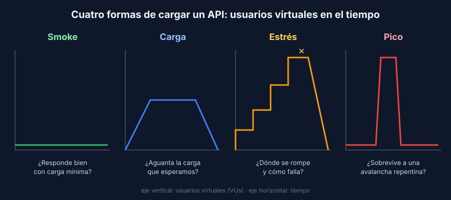

# Tipos de prueba de carga

> Transversal: aplica a todos los stacks.

## Una pregunta distinta

Las semanas anteriores preguntaron "¿responde **bien**?". Las pruebas de carga preguntan "¿responde bien **cuando muchos piden a la vez**, y a qué velocidad?". Un endpoint puede pasar todos sus tests y caerse con 50 personas: los tests de antes no lo ven porque hacen una petición por vez.

La herramienta simula personas con **usuarios virtuales** (VUs). Cada VU repite el mismo guion (pedir la lista, registrar una pieza, esperar un segundo) durante el tiempo que dura la prueba. Una vuelta completa del guion es una **iteración**.

## Los tipos

Lo que cambia entre un tipo y otro es **cuántos VUs hay en cada momento**.



| Tipo | Forma | Pregunta que responde | Duración típica |
|---|---|---|---|
| **Smoke** | 1 a 2 VUs, plano | ¿El script y el API funcionan con carga mínima? | 30 s a 1 min |
| **Carga** (*load*) | Rampa, meseta y bajada hasta la carga esperada | ¿Aguanta el uso normal cumpliendo los umbrales? | 5 a 30 min |
| **Estrés** (*stress*) | Escalones por encima de lo esperado | ¿Dónde se rompe y **cómo** falla? | Hasta que falle |
| **Pico** (*spike*) | Subida brusca y corta | ¿Sobrevive a una avalancha (inicio de inscripciones, un enlace viral)? | Pocos minutos |
| **Resistencia** (*soak*) | Carga normal durante horas | ¿Hay fugas de memoria o conexiones que se acumulan? | Horas |

El orden importa: primero smoke (si falla con 1 VU, el problema es el script o el API, no la carga), después carga y al final estrés. La resistencia no cabe en una clase de 8 horas. Se menciona para que sepas que existe.

## ¿Cuántos usuarios son "carga esperada"?

Sale del proyecto, no de la herramienta. Para un sistema de inscripciones de un centro SENA con 600 aprendices, que 60 entren en el mismo minuto es razonable; 5 000 no. Escribe la cuenta en el PR:

```text
600 aprendices · 10% entra en el minuto pico = 60 personas
cada una hace ~3 peticiones por minuto = 180 peticiones/min = 3 peticiones/s
```

Con esa cuenta, una prueba de carga de 20 VUs con `sleep(1)` ya está por encima de lo esperado, y la de estrés busca el límite real.

## Dónde se corre

> ⚠️ **Nunca contra producción ni contra un servidor que no es tuyo.** Una prueba de estrés es, para quien la recibe, igual a un ataque de denegación de servicio. Contra un servidor compartido tumba el trabajo de otros; contra uno ajeno puede ser un delito.

Córrela contra tu API en tu equipo o en un entorno de pruebas del grupo, con la BD de prueba de la semana 6 (`docker compose`). Dos cuidados:

1. **Los datos importan.** La misma consulta tarda distinto con 10 filas que con 10 000. Decide con cuántos datos mides y anótalo con el resultado.
2. **La prueba deja datos.** Si el guion registra piezas, la tabla crece en cada corrida y la siguiente medición ya no es comparable. Empieza cada corrida con la BD limpia (`docker compose down -v`).

El generador de carga también consume CPU. En un portátil, k6 y el API compiten por el mismo procesador: los números sirven para **comparar** (antes y después de un cambio, un endpoint frente a otro), no como la capacidad real del servidor de producción.

---

## Navegación

| ← Anterior | Inicio | Siguiente → |
|---|---|---|
| [Semana 11 (opcional) — Pruebas de carga y estrés](../README.md) | [Semana 11 (opcional)](../README.md) | [Métricas y umbrales](02-metricas-y-umbrales.md) |
